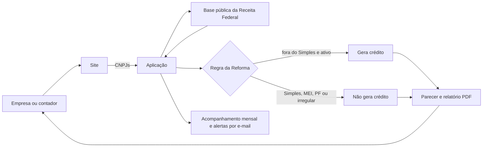

# Consulta Reforma

Ferramenta da Reforma Tributária: pelo CNPJ, mostra na hora se o fornecedor vai gerar crédito de CBS/IBS e qual é o regime dele. No ar em [consultareforma.tec.br](https://consultareforma.tec.br/).

## Problema

Com a Reforma Tributária, comprar de fornecedor do Simples Nacional, MEI, pessoa física ou com CNPJ irregular deixa de gerar crédito integral de CBS/IBS. A escolha do fornecedor passa a pesar no caixa a partir de 2027, e a maioria das empresas não sabe quais fornecedores da sua carteira estão nesse grupo.

## Solução

- **Consulta por CNPJ ou CPF**, um a um ou em lista colada.
- **Parecer por fornecedor:** situação na Receita, regime tributário, se gera crédito e, nos planos pagos, certidão federal e crédito estimado em reais a partir das compras informadas.
- **Relatório em PDF** da carteira de fornecedores.
- **Acompanhamento:** verificação mensal de certidão e status, e alerta por e-mail quando um fornecedor muda.
- **Notícias semanais** sobre a Reforma Tributária.

## Como funciona

Mais detalhes em [docs/arquitetura.md](docs/arquitetura.md).

## Stack

- Aplicação web própria
- Dados públicos da Receita Federal (situação cadastral, Simples Nacional e MEI, certidão federal)
- Mercado Pago para pagamentos

## Meu papel

Sou **cofundador**. A partir do escopo do meu sócio, especialista no setor, construí o site, a aplicação, a operação e as vendas.

## Status e resultados

- No ar em [consultareforma.tec.br](https://consultareforma.tec.br/), em fase inicial.

## O que aprendi

- **Oferta e venda valem mais do que a ideia e a construção em si**, e a velocidade decide muita coisa.

## Contato

[guilhermesint.gerencia@gmail.com](mailto:guilhermesint.gerencia@gmail.com) · portfólio [guilhermevictaliano.github.io](https://guilhermevictaliano.github.io) · LinkedIn [linkedin.com/in/guilherme-victaliano-de-meira-b73933343](https://www.linkedin.com/in/guilherme-victaliano-de-meira-b73933343)

---

## English

**Consulta Reforma** is a Brazilian Tax Reform tool, live at consultareforma.tec.br.
Type a supplier's company ID (CNPJ) and instantly see its tax regime and whether purchases from it will generate CBS/IBS tax credits from 2027 on.
Paid plans add the federal tax-clearance certificate, an estimated credit in BRL, PDF reports, monthly monitoring and email alerts.
I am a co-founder: from my partner's scope as the tax expert, I built the website, the application, operations and sales. Source code is private; demo on request.
