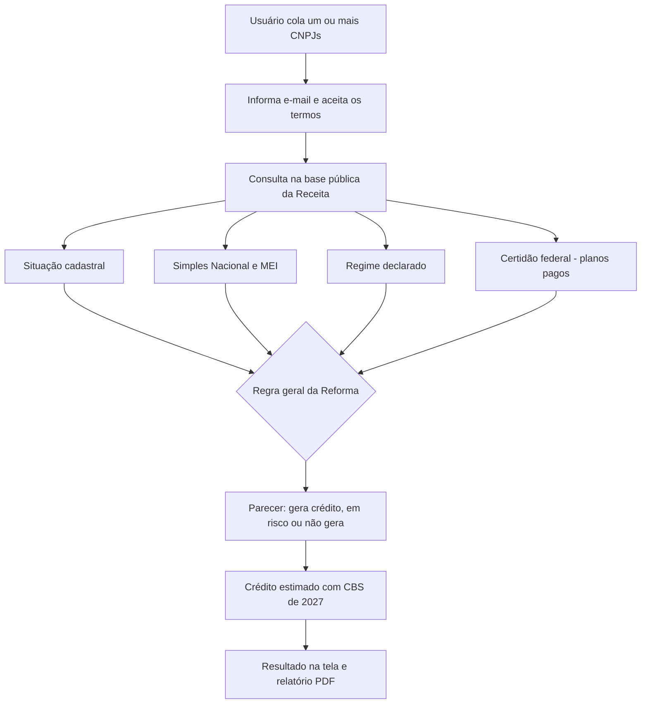

# Arquitetura: Consulta Reforma

Visão de alto nível, limitada ao que o produto já mostra publicamente em [consultareforma.tec.br](https://consultareforma.tec.br/).

## Fluxo da consulta

## Regra de classificação

| Situação do fornecedor | Resultado |
|---|---|
| Fora do Simples, CNPJ ativo, certidão em dia | Gera crédito |
| Fora do Simples, sem certidão emitida | Crédito em risco |
| Simples Nacional, MEI, pessoa física ou CNPJ irregular | Não gera crédito integral |

## O que é regra e o que é IA

A classificação é **regra**, não IA: segue a regra geral da Reforma (Emenda Constitucional 132/2023 e Lei Complementar 214/2025) sobre dados públicos da Receita Federal.

## Acompanhamento

Nos planos pagos, os fornecedores da carteira são verificados todo mês (certidão e status), e o usuário recebe alerta por e-mail quando algo muda.
